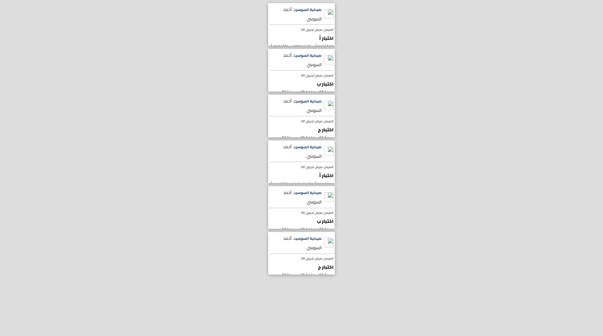
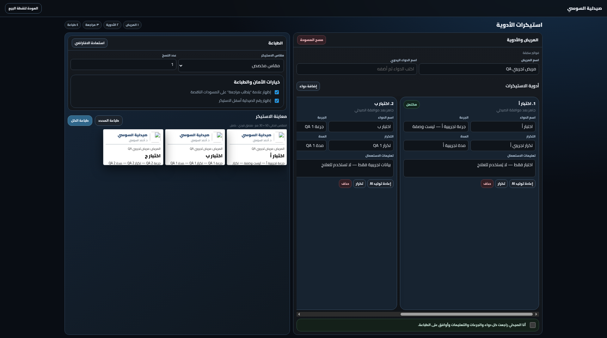
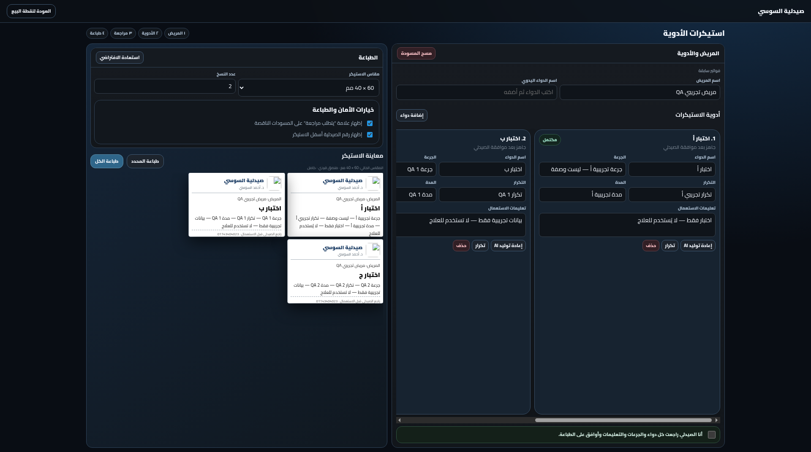
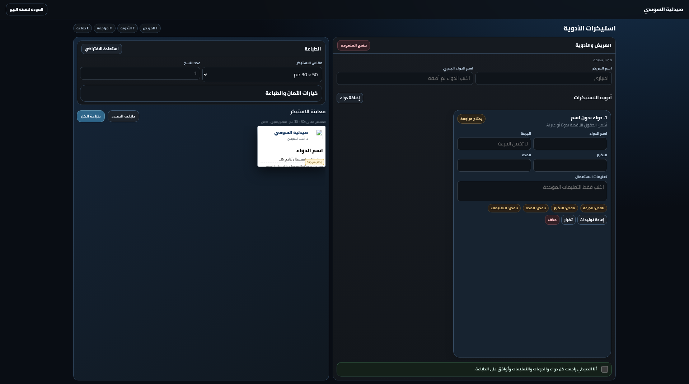
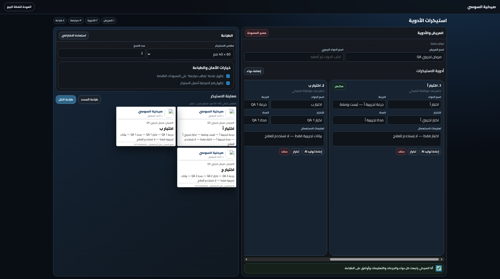
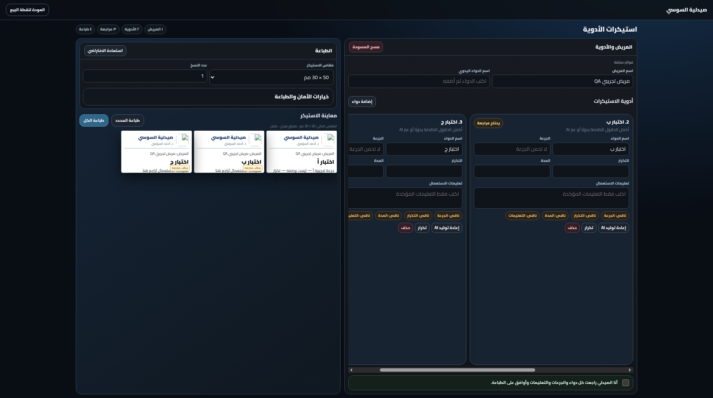
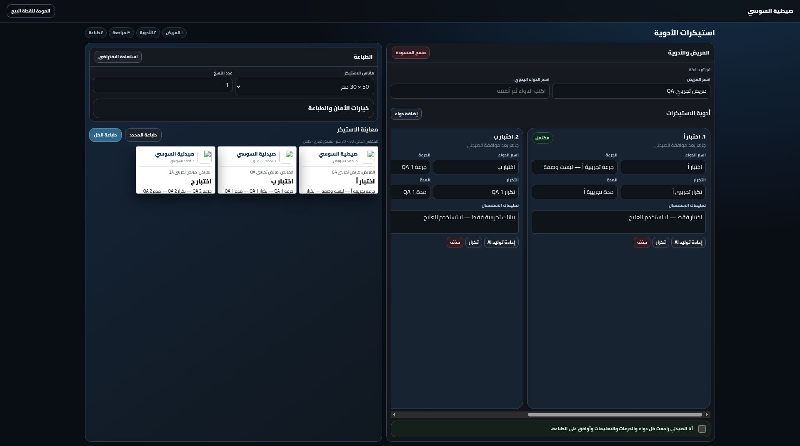

# STICKER_STUDIO_VISUAL_QA

تقرير مراجعة شكل الواجهة المنشورة — 6 نوفمبر 2026، بتوقيت الرياض. النتيجة جزئية، ومش اعتماد للمقاسات المطلوبة.

## Overall: FAIL — provisional 48/100

المراجعة على الواجهة الحيّة فقط:
https://nova-rx-preview.elsousypharmacy.workers.dev/sticker-studio.html

مرجع الكوميت `f8cdf81` اتبعت لنا، لكن مفيش معرّف بناء ظاهر على الصفحة يأكد إن النسخة المنشورة هي الكوميت ده. هوية النشر **غير متحقَّق منها**، ومتعتبرش `f8cdf81` إثبات إن ده اللي متنشر.

مفيش فحص للسورس، ولا لأدوات المطوّر، ولا للباك إند. مفيش أي تعديل أو نشر أو رفع ملفات أو رسائل. البيانات تجريبية بس، واللي اتكتب أو اتولّد مش نصيحة طبية.

## Viewports / limits

مقاس نافذة المتصفح الفعلي: **1920×1072 CSS pixels**، وده مطابق لأبعاد لقطات الصفحة. ضبط المقاس بالظبط مش متاح وممنوع من أداة المتصفح، فـ **1024×768 NOT TESTED**. متعتبرش النتيجة دي اعتماد للتابلت.

المقاسات دي كمان **NOT TESTED** لأن تغيير المقاس بالظبط مش متاح في جلسة المتصفح دي: 1180×820، 1366×1024، 390×844، 1440×900.

لقطات سطح المكتب الأصلية 1280×800، ومش هي نفس CSS viewport بتاع الصفحة.

الخمسة مقاسات المطلوبة بالظبط كلها **NOT TESTED**.

## Scenario results

| السيناريو | النتيجة |
|---|---|
| الشاشة الأولى | PASS التحميل؛ مش قبول للتصميم. [01-initial.png](screenshots/01-initial.png) |
| المريض + تلات أدوية | PASS: مريض تجريبي QA؛ اختبار أ / اختبار ب / اختبار ج. الكارت الفاضي الأول اتغير اسمه لـ أ، واتضاف ب و ج بالإدخال اليدوي. [02-three-drugs.png](screenshots/02-three-drugs.png) |
| التنقل الأفقي | PASS: العجلة الأفقية فوق الشريط بتظهر ج؛ وشريط التمرير باين كمان. [03-horizontal-navigation.png](screenshots/03-horizontal-navigation.png) |
| تعديل الجرعة/التكرار/المدة/التعليمات | PASS على التلاتة؛ نصوص QA واضحة إنها مش سريرية وظهرت في المعاينة. [04-after-ai.png](screenshots/04-after-ai.png) |
| الذكاء الاصطناعي لـ ب بس | PASS للتشغيل: ب لوحدها ظهر عليها جاري التوليد والزر اتقفل، وبعدين رجعت مكتمل. القيم ما اتغيرتش؛ أ و ج ما اتغيروش. الناتج المتولّد الجديد NOT VERIFIED. مفيش طلب دفع أو رصيد. [04-after-ai.png](screenshots/04-after-ai.png) |
| الوصول لمقاسات جاهزة وتغييرها | PASS: اتختاروا الـ 8 مقاسات الجاهزة واتراجع ملخص المقاس الحالي: 50×30، 40×30، 40×25، 50×25، 58×40، 60×40، 70×50، 100×50 mm. وضوح الطباعة الكامل لكل مقاس NOT TESTED. |
| المقاس المخصص | FAIL: اختيار الخيار مش بيظهر أي أبعاد، والملخص بيرجع لـ 50×30. [06-custom-and-settings.png](screenshots/06-custom-and-settings.png) |
| ورق فردي/مقسوم | الملخص بيظهر Individual؛ FAIL في الوصول لمُحدّد وضع الورق وخيار split. [11-expanded-settings.png](screenshots/11-expanded-settings.png) |
| الهوامش/الاتجاه | FAIL في الوصول لتحكم التطبيق، حتى والخيارات مفتوحة. Margins في نافذة الطباعة الأصلية مش إعداد داخل التطبيق. [11-expanded-settings.png](screenshots/11-expanded-settings.png) |
| عدد النسخ | PASS من 1 لـ 2؛ القيمة فضلت محفوظة؛ المعاينة طلعت 6 صفحات لـ 3 أدوية × 2. [08-native-print-preview.webp](screenshots/08-native-print-preview.webp) |
| الطباعة النهائية قبل الموافقة | PASS والطباعة اتمنعت: الضغط على طباعة الكل والموافقة مش متعلّمة أظهر موافقة الصيدلي إلزامية قبل الطباعة، ونقل التركيز لمربع الموافقة الفاضي؛ مفيش نافذة طباعة. [05-approval-block.png](screenshots/05-approval-block.png) |
| الوصول لطباعة تجريبية مخصصة | FAIL: مفيش زر Test Print، حتى في الإعدادات المفتوحة. [11-expanded-settings.png](screenshots/11-expanded-settings.png) |
| معاينة طباعة المتصفح / الإلغاء | PASS للفتح والإلغاء بس: بعد موافقة تجريبية، طباعة الكل فتحت المعاينة الأصلية (الوجهة Save as PDF)؛ اتضغط Cancel، ومفيش حاجة اتحفظت أو اتطبعت. FAIL في محتوى المخرج: سطور التعليمات مقصوصة. الدليل: [08-native-print-preview.webp](screenshots/08-native-print-preview.webp) و [09-print-document-clipping.png](screenshots/09-print-document-clipping.png) |
| تحديث الصفحة والمسودة | PASS: المريض، والتلات أدوية، والحقول المعدّلة، و60×40 mm، وعدد النسخ 2 رجعوا. الموافقة اترجعت فاضية زي ما يلزم؛ والخيارات اتقفلت. [10-persisted-draft.png](screenshots/10-persisted-draft.png) |
| التمرير الرأسي جوه الكارت | PASS بس على المقاس الفعلي: العجلة الرأسية فوق أ سابت زر الذكاء الاصطناعي عند نفس y=569.25؛ كل حقوله وأزراره باينة. مفيش استنتاج عن التابلت. |
| لوحة مفاتيح أساسية | PASS: من حقل المريض → Tab ركّز على حقل الدواء اليدوي. مراجعة كاملة للوحة المفاتيح/إتاحة الوصول NOT TESTED. |
| لوحة مفاتيح اللمس الحقيقية | NOT TESTED: سطح المكتب مش بيقدر يعيد تغطية لوحة التابلت للحقول. |
| طباعة المحدد فقط | NOT TESTED؛ اللي اتجرب هو طباعة الكل بس. |

## Findings by priority

صور الدليل تحت مجلد `screenshots/` جنب التقرير ده. المسار المحلي القديم `/workspace/sticker-studio-qa/` اتبدل بروابط صور نسبية.

### P0 — قص محتوى ملصق الطباعة (حرج)

خطوات الإعادة: املأ تلات أدوية بكل الحقول → 60×40 mm → عدد النسخ 2 → وافق موافقة تجريبية → طباعة الكل. معاينة الطباعة الأصلية فيها عنوان صيدلية كبير وملفوف؛ سطر تعليمات أ بيبدأ من تحت وبيتقطع. بعد Cancel، المستند المتولّد باين إنه بيقص التعليمات في الست ملصقات. المعاينة الحية كانت بتظهر تعليمات أكتر من مخرج الطباعة.

الدليل: [08-native-print-preview.webp](screenshots/08-native-print-preview.webp)، [09-print-document-clipping.png](screenshots/09-print-document-clipping.png)؛ قارن بـ [07-60x40-preview.png](screenshots/07-60x40-preview.png). ده دليل بصري على المخرج، مش تشخيص للباك إند أو للطابعة. مفيش طباعة ورقية.

الاقتراح: توحيد مقاسات المعاينة والمخرج، تصغير الهوية البصرية، حجز مساحة للتعليمات، لف النص جوه حدود الملصق، ومنع الطباعة النهائية لو المحتوى طافح، مع اقتراح مقاس أكبر.

### P1 — أبعاد المقاس المخصص مش قابلة للوصول

خطوات الإعادة: اختار مقاس مخصص وخيارات الأمان/الطباعة مفتوحة. مفيش حقول عرض/ارتفاع بتظهر؛ ملخص المقاس الحالي بيقرأ 50×30 رغم اختيار المخصص.

الدليل: [06-custom-and-settings.png](screenshots/06-custom-and-settings.png).

الاقتراح: إظهار حقول عرض وارتفاع بالملم فورًا، بأسماء واضحة، مع تحقق من القيم، وأبعاد حية صحيحة.

### P1 — إعداد الطباعة المطلوب / الطباعة التجريبية مش قابلة للوصول

خطوات الإعادة: افتح خيارات الأمان والطباعة. اللي بيظهر مربعي موافقة/تذييل بس. مفيش ورق فردي/مقسوم، ولا هوامش التطبيق، ولا الاتجاه، ولا Test Print مخصص. الأزرار الظاهرة هي طباعة المحدد/الكل النهائية بس. مفيش ادعاء عن قدرات مخفية في السورس.

الدليل: [11-expanded-settings.png](screenshots/11-expanded-settings.png)، [06-custom-and-settings.png](screenshots/06-custom-and-settings.png).

الاقتراح: عناصر وصول مختصرة لوضع الورق والاتجاه والهوامش وعدد النسخ؛ وزر Test Print ثابت جنب الطباعة النهائية المقفولة بالموافقة. غياب أو تعذّر الوصول لإجراء الطباعة التجريبية الأساسي درجة P1.

### P2 — الشعار مكسور

خطوات الإعادة: أول تحميل، أو طباعة أي ملصق تجريبي. أيقونة صورة مكسورة جنب عنوان الصيدلية في الواجهة الحية وفي مخرج الطباعة.

الدليل: [01-initial.png](screenshots/01-initial.png)، [07-60x40-preview.png](screenshots/07-60x40-preview.png)، [08-native-print-preview.webp](screenshots/08-native-print-preview.webp).

الاقتراح: شعار صغير شغال مع نص بديل ما يسيبش مربع صورة مكسور أو فاضي؛ والتأكد من ظهوره في نافذة الطباعة.

### P2 — ملصقات صغيرة ومزدحمة جنب مساحة فاضية كبيرة

خطوات الإعادة: تلات أدوية مليانة، المقاس الافتراضي 50×30، وبعدين 60×40. الكروت بطول الشاشة فيها مساحة فاضية كبيرة تحت، والمعاينة لسه صغيرة. معاينة المقاس الافتراضي بتقص النص أو بتخليه صغير جدًا؛ ونص المساعدة العربي الباهت صعب قراءته. مفيش قياس رقمي للتباين.

الدليل: [02-three-drugs.png](screenshots/02-three-drugs.png)، [07-60x40-preview.png](screenshots/07-60x40-preview.png).

الاقتراح: معاينة الملصق المختار قابلة للتكبير وبتتظبط على اللوحة، مع زر للمقاس الحقيقي؛ ومتخليش جسم الكارت يتمط لارتفاع الشاشة. نص ثانوي أوضح، وحقول عربية مقروءة، ومساحات لمس أكبر.

### P2 — التنقل الأفقي مش واضح

خطوات الإعادة: ضيف تلات أدوية. كارت كامل وجزء من اللي بعده باينين؛ التالت بره الشاشة؛ ومحتاج عجلة أفقية أو شريط تمرير. مفيش أزرار واضحين للي قبل/بعد أو عداد للكروت. كل أزرار الكارت وصلت بالتمرير، فخروج الكارت بره الشريط الأفقي لوحده مش P1 لزر أساسي مخفي.

الدليل: [02-three-drugs.png](screenshots/02-three-drugs.png)، [03-horizontal-navigation.png](screenshots/03-horizontal-navigation.png).

الاقتراح: السابق/التالي ظاهرين باتجاه RTL، ورقائق أسماء الأدوية، وعداد 1 من 3؛ وإظهار الكارت الجديد أول ما يتضاف.

### P2 — نتيجة الذكاء الاصطناعي ما اتغيرتش من غير تفسير

خطوات الإعادة: املأ ب كامل → أعد توليد الذكاء الاصطناعي. حالة الانشغال بتخلص، والقيم زي ما هي؛ مفيش تفسير ثابت يقول إذا النص المتأكد منه اتحافظ عليه ولا الاقتراحات مش متاحة. ده مش دليل على عطل في الباك إند.

الدليل: [04-after-ai.png](screenshots/04-after-ai.png) (الحالة بعد الانتهاء)؛ انتقال الانشغال اتلاحظ في شجرة الإتاحة الحية.

الاقتراح: رسالة صريحة بالنجاح أو بعدم التغيير، وفرق اقتراح لكل حقل.

## Design assessment / removals

الإيجابي: تخطيط داكن RTL من عمودين ومتماسك؛ المحرر يمين والمعاينة شمال مناسبين للشغل. عرض الكروت ثابت، والعناوين واضحة، والحقول عليها تسميات، وفيه قفل موافقة. إضافة دواء والذكاء الاصطناعي والموافقة وطباعة الكل واصلين على المقاس الفعلي؛ مفيش ادعاء إن التابلت مظبوط.

المشاكل: مساحة فاضية كبيرة بارتفاع متساوي؛ معاينات المقاس الحقيقي صغيرة من غير تكبير واضح؛ نصوص مساعدة عربية صغيرة وباهتة؛ تكرار رسائل الحالة والمساعدة؛ شعار مكسور وهوية الصيدلية طاغية على الملصق المطبوع على حساب التعليمات. تلميع P3: تخفيف ظلال وحدود المعاينة التقيلة بعد ما القراءة والمخرج يتظبطوا.

عناصر مكررة يقترح تقليصها: سطور الحالة/المساعدة المتكررة، وحبوب المراحل لو مش قابلة للتنقل؛ وتقليل تكرار اسم الصيدلية/الطبيب والمساحة الفاضية بطول الشاشة. انقل Clear Draft/reset لقائمة ثانوية، مش جنب موافقة الأمان والتحذيرات.

## Proposed tablet landscape arrangement (untested proposal)

اقتراح غير مُختبَر، ومش نتيجة مقاس تابلت:

شريط علوي رفيع للمريض وإضافة الدواء. يمين 55–60% محرر الدواء النشط، ورقائق الأدوية مع السابق/التالي باتجاه RTL، والجرعة/التكرار/المدة في عمودين مختصرين، والتعليمات بعرض كامل، والذكاء الاصطناعي في التذييل. شمال 40–45% معاينة الملصق المختار قابلة للتكبير، وفوق إعدادات مختصرة للمقاس والورق وعدد النسخ. شريط سفلي ثابت: الموافقة + Test Print + الطباعة النهائية المقفولة؛ من غير تمرير رأسي جوه الكارت. الهوامش والاتجاه والأبعاد المخصصة في لوحة قابلة للوصول وفيها ملخص واضح. هدف مساحات اللمس 44–48px ونص عربي مقروء. التحقق في المرحلة الجاية على 1024×768 الحقيقي ومع لوحة مفاتيح اللمس الفعلية.

## Requested viewport matrix

| المقاس المطلوب | الحالة | السبب |
|---|---|---|
| 1024×768 | NOT TESTED | ضبط المقاس بالظبط مش متاح |
| 1180×820 | NOT TESTED | ضبط المقاس بالظبط مش متاح |
| 1366×1024 | NOT TESTED | ضبط المقاس بالظبط مش متاح |
| 390×844 | NOT TESTED | ضبط المقاس بالظبط مش متاح |
| 1440×900 | NOT TESTED | ضبط المقاس بالظبط مش متاح |

## Handoff

الشغل وقف هنا. المسودة التجريبية لسه على الجهاز: تلات أدوية مليانة، 60×40 mm، نسختين، الموافقة مش متعلّمة، والخيارات مفتوحة. تبويب الطباعة المتولّد اتقفل بعد الإلغاء. الكمبيوتر استخدم بس لمعاينة طباعة Chrome الأصلية والإلغاء. مفيش حاجة اتطبعت أو اتحفظت أو اترفعت أو اتبعتت وقت المراجعة. مفيش كوميت GitHub اتعمل أثناء جلسة المراجعة دي. مخرجات المراجعة كانت التقرير المحلي و11 لقطة.
